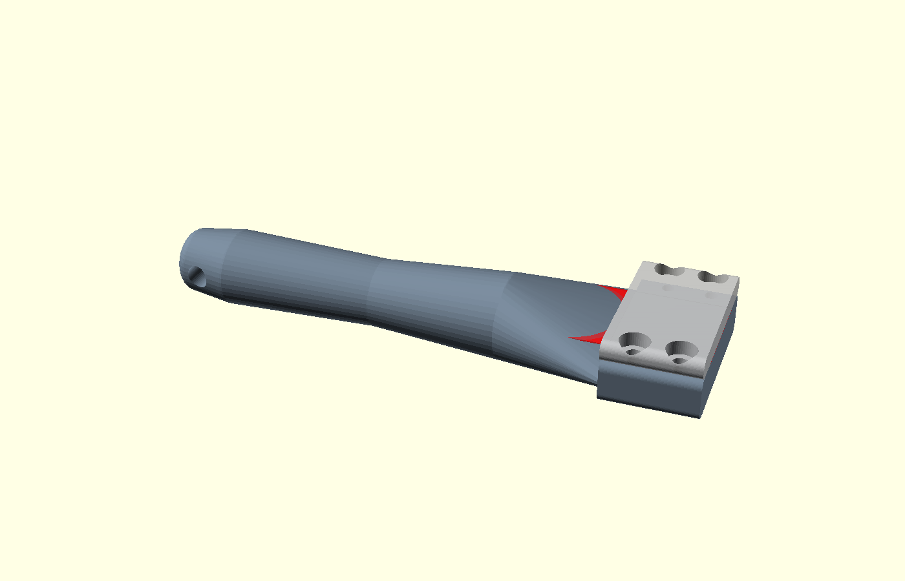

# Razor Blade Print-Bed Scraper

A 3D-printable handle for a standard razor blade, purpose-built for slicing
brims, rafts, and elephant's-foot squish off the bottom edge of prints
without touching the blade with your fingers.

## Why

A bare blade held between two fingers works but gives poor leverage and no
standoff from the sharp edge. This holder gives you an ergonomic, tapered
grip with only 8mm of cutting edge exposed — enough to get under stuck
brim/raft plastic and shave it flush with the bed contact surface, but not
so much that the blade can flex, snap, or bite your fingers if it catches.

## How it works

Two printed parts sandwich a standard blade against a flat shelf and are
drawn together with four M3 screws. The clamp is pure friction against a
flat surface (not blade-specific holes), so the same design fits either:

- A standard **double-edge safety razor blade** (43 x 22 x 0.10mm) — the
  cheapest, most universally available option, sold at any drugstore.
- A **single-edge utility/craft blade** (~38-41 x 19 x 0.23mm).

Flip or replace the blade whenever it dulls; both parts are reusable.

## Files

- `razor_blade_scraper.scad` — parametric OpenSCAD source. Open it in
  OpenSCAD and adjust the `[Blade]` / `[Hardware]` / `[Handle geometry]`
  parameters at the top if you want a different exposure length, a wider
  jaw, etc.
- `razor_blade_scraper_body.stl` — the handle/lower jaw, pre-exported.
- `razor_blade_scraper_cap.stl` — the upper clamp plate, pre-exported.

Both STLs were exported straight from the `.scad` file at the default
parameter values and verified manifold (watertight) before committing.

## Bill of materials

- 2x printed parts (above)
- 4x M3 x 10mm screws (socket-head cap screws recommended)
- 1x standard razor blade (DE safety blade or single-edge utility blade)

No nuts, no heat-set inserts required — the screws self-tap directly into
printed pilot holes in the body. If you print in a hard/brittle filament
(PETG is fine; avoid pure PLA-glass or heavily-filled composites for this
part) or plan to assemble/disassemble often, swap in M3 heat-set inserts
for longevity — the pilot holes are sized to also accept an M3 heat-set
insert with light reaming.

## Print settings

- Layers: 0.2mm
- Walls: 3+ (the jaw needs to resist screw clamp-up torque)
- Infill: 20%+
- No supports needed — both parts are modeled to print flat on the bed
  (see `print_layout()`, the default render).
- Material: PETG or ABS preferred for the jaw/cap (more tolerant of the
  screw clamp-up stress than plain PLA), but PLA will work fine too.

## Assembly

1. Insert the blade into the shallow pocket on top of the body's jaw,
   pushed all the way back until it seats against the shoulder. About
   8mm of edge will protrude past the front of the jaw.
2. Place the cap on top, aligning its four holes with the body's four
   pilot holes.
3. Drive in the four M3 screws, snugging evenly in a cross pattern
   (like a wheel) so the cap clamps down flat rather than tilting.
   Snug is enough — you're pinching a ~0.1-0.25mm shim, not bolting
   structural steel.

## Use

Hold the tool like a pencil or a paint scraper. Draw the exposed edge
along the underside perimeter of the print at a shallow angle to shave
off brim/raft remnants and skirt witness marks flush with the surface
that touched the bed. The short exposure length keeps the cut controlled
and limits how much blade can flex or dig in.

## Safety notes

- Only ~8mm of blade is exposed by design — resist the urge to seat the
  blade less deeply "for more reach." That defeats the point.
- Store the tool with a bit of tape over the exposed edge, or point-down
  in a cup/holder, when not in use.
- Replace the blade rather than fighting a dull one — the extra force
  needed to cut with a dull edge is what causes slips.
- Standard safety-razor and utility blades are genuinely sharp; treat
  this as you would any bladed hand tool.
